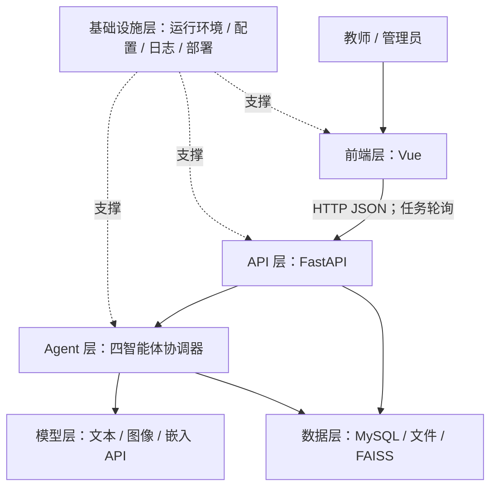

# PhyQGen 系统设计技术方案


## 1. 项目概述

### 1.1 背景与目标

- 面向：高中物理教师；管理员负责维护；学生为题目使用者。
- 痛点：手工编题耗时；通用生成工具容易出现物理错误、答案矛盾和图文不符等问题。
- 目标：教学要求可配置；文本与配图协同生成；内部自动校验；节省编题时间，提高习题质量。

### 1.2 核心功能与范围

| 编号 | 功能 | 优先级 | 关键要点 |
|---|---|---|---|
| F-01 | 出题需求配置 | P0 | 年级、知识点、题型、认知目标、难度、思维标签 |
| F-02 | 异步任务 | P0 | 逐题进度、有限并发、保存策略 |
| F-03 | 检索增强 | P0 | 知识库，引用来源，执行策略 |
| F-04 | 文本与配图 | P0 | 题干、选项、答案、解析；按需配图 |
| F-05 | 自动校验与修订 | P0 | 文本正确性、图文一致性；默认最多 3 轮 |
| F-06 | 教师审核与题库 | P0 | 编辑、版本、确认定稿、筛选、单题/多题 TXT |
| F-07 | 账户与维护 | P0 | 教师注册；账号、模型、知识库、执行配置管理 |
| F-08 | 优秀习题与讨论 | P2 | 保留旧系统扩展入口 |

边界：辅助编题，输出待审核草稿；教师承担最终核验。首版不包含学生答题、自动组卷、学情推荐与 Word/PDF 导出。

思维标签：C1 建模表征、C2 推理定量、C3 证据解释、C4 实验数据、C5 质疑创新、C6 迁移整合；与认知目标、难度分别记录。

### 1.3 质量要求

| 属性 | 要求 | 验证方式 |
|---|---|---|
| 内容质量 | 物理规律、条件、单位、答案与图文一致；教师确认后定稿 | 样题评审 |
| 响应与可靠性 | 异步执行；超时可定位；保留可用草稿；保存后才报成功 | 故障注入、耗时日志 |
| 安全与追溯 | 角色及资源隔离；来源、版本、确认记录可追溯 | 越权测试、记录核对 |
| 性能与成本 | 记录阶段耗时、调用数及 token；阈值试评后确定 | 真实模型测试 |

## 2. 开发与运行环境

| 类别 | 技术 / 版本依据 | 选择理由 |
|---|---|---|
| 前端 | Vue 3.4 系列、TypeScript 5.3.3、Vite 5 系列 | 类型检查、构建方便 |
| 交互与展示 | Element Plus 2.4、Pinia 2.1、Vue Router 4.2；Marked 11、KaTeX 0.16 | 表单、状态、路由、公式展示 |
| 后端运行时 | Python，建议统一 3.11；Uvicorn 0.27.0 | 异步服务完善 |
| API / 校验 | FastAPI 0.109.0、Pydantic 2.5.3 | 类型校验、异步接口、自动接口文档 |
| 数据访问 | MySQL 8 系列、SQLAlchemy 2.0.25、Alembic 1.13.1、aiomysql 0.2.0 | 业务事务与迁移 |
| 模型与检索 | OpenAI SDK 1.10.0；FAISS、NumPy、pypdf、python-docx | 兼容 API、本地索引、资料解析 |

- 环境：原型已在 Windows、Node.js 20.19.5 验收；完整系统还需要 Python、MySQL，以及可访问模型服务的网络环境。首轮测试建议 4 核/8GB，云端推理。
- 工具：VS Code、Git/GitHub、npm/pip、Swagger、Playwright；外部模型按实际用量计费，部署平台待定。
- 依赖：前端使用 `package-lock.json`；后端 RAG 依赖尚有版本范围，联调后锁定。
- 配置：模型/地址/并发/轮次集中管理；API Key、数据库密码、JWT 密钥迁至服务端环境变量，前端脱敏。

## 3. 总体架构

### 3.1 六层架构



当前原型通过本地适配器处理请求，并使用 localStorage 保存数据；上图为目标结构。

| 层 | 输入 → 输出 | 依赖与职责 |
|---|---|---|
| 前端 | 教学要求、教师操作 → 页面、请求、TXT | API；配置、进度、编辑与确认 |
| API | 请求、身份 → 任务、题目、错误响应 | Agent、数据库；校验、授权、事务 |
| Agent | 教学约束、证据 → 草稿、内部反馈 | 模型、检索；调度、修订、结果汇总 |
| 模型 | 提示词、蓝图、图片 → 文本、图片、向量 | 外部服务；生成与校验 |
| 数据 | 业务记录、资料 → 查询、证据、版本 | MySQL、文件、FAISS；持久化与追溯 |
| 基础设施 | 代码、配置 → 运行服务、日志、备份 | 操作系统、运行时；部署与维护 |

### 3.2 请求链路与关键决策

`教师提交 → API 校验与任务落库 → 后台编排 → 逐题草稿保存 → 前端轮询 → 教师修改/确认 → 定稿导出`

| 决策 | 理由 | 代价 |
|---|---|---|
| Vue + FastAPI 前后端分离 | 接口清晰 | 需要联调与身份传递 |
| 自研 asyncio 固定编排 | 生成、配图、校验依赖明确；便于追踪 | 需自行维护状态和异常 |
| MySQL + 本地 FAISS | 事务管理业务；小规模知识库部署简单 | 索引需单独备份、更新 |

## 4. 前端层

| 页面 / 组件 | 职责与关键状态 |
|---|---|
| 登录、教师概览、个人中心 | 身份、账户资料、题库统计 |
| 习题生成、生成任务、TaskProgress | 配置；任务 ID、逐题阶段、轮次、异常 |
| 我的题库、QuestionPreview | 搜索筛选；公式图片预览、编辑版本、教师确认、TXT |
| 管理后台 | 账号、模型连接、知识库、并发/轮次、维护日志 |
| 优秀习题、讨论 | 保留的评分与交流入口 |

- 【原型】编辑、版本、确认及下载可用；模型、检索、索引维护为模拟。
- 接入：通过 HTTP 请求替换 `legacy-api` 中的本地调用；开发期 `/api` 代理，生产期同域；任务 ID 轮询，统一错误提示。
- 展示：生成进度与教师状态分开；显示来源与异常；内部校验意见不向教师展示。
- 安全：保留 HTML 转义和链接限制；在服务端补充对上传图片类型和大小的校验。

## 5. API 层

职责：路由、参数校验、鉴权、资源归属、跨域、限流、异常与接口文档。

拟定核心接口，前缀 `/api/v1`；任务、版本、确认及导出需新增或改造。

| 方法 | 路径 | 输入 → 输出 | 权限 |
|---|---|---|---|
| POST | `/auth/login`、`/auth/register` | 账户资料 → 登录凭据 / 教师账户 | 公开；注册固定教师角色 |
| POST / GET | `/tasks` | 出题要求 / 分页 → 任务 ID / 本人任务列表 | 教师 |
| GET | `/tasks/{id}` | 任务 ID → 阶段、逐题结果、错误摘要 | 所属教师 |
| GET / PATCH / DELETE | `/questions/{id}` | 题目 ID、编辑内容 → 详情 / 新版本 / 删除结果 | 所属教师 |
| GET | `/questions` | 关键词、教学属性、确认状态 → 分页列表 | 教师；仅本人 |
| POST | `/questions/{id}/confirm`、`/questions/export` | 当前版本 / 题目 ID 列表 → 确认记录 / TXT | 所属教师 |
| GET / PUT | `/admin/settings` | 查询 / 维护配置 → 脱敏配置、操作结果 | 管理员 |
| GET | `/health` | 无 → 服务与依赖状态 | 探活；不返回敏感信息 |

核心结构：

```text
GenerationRequest：knowledge_point、grade、question_type、bloom_level、difficulty、
                   thinking_tags、count(1..5)、use_kb、require_illustration、context
TaskResponse：task_id、stage、items[{index,status,attempt,question_id,error}]、saved_count
Question：id、current_version、content、answer、explanation、illustration、evidence、teacher_status
ConfirmRequest：version；由服务端取得 teacher_id，并校验当前版本
```

- 鉴权：JWT + bcrypt；服务端取得身份，检查角色、账号状态及归属。旧版生成/进度接口鉴权不完整，需修正。
- 错误约定：400 业务条件；401 未登录；403 越权；404 不存在；409 版本冲突；422 字段错误；500 内部错误；503 服务不可用。统一 `code、message、request_id`。

## 6. Agent 层

### 6.1 角色与编排

四个智能体按固定流程协作，由自研 asyncio 协调器调度。

| 模块 | 输入 → 输出 | 实现依据 |
|---|---|---|
| Planner 命题设计 | 教学约束、检索证据、修订意见 → 题干、答案、解析、配图蓝图 | docs/requirements/functional+nonfunctional_spec.md |
| Generator 配图绘制 | 蓝图、题目版本 → 配图 | docs/requirements/functional+nonfunctional_spec.md |
| Reviewer1 文本校验 | 题干、选项、答案解析 → 物理/计算问题及修订建议 | docs/requirements/functional+nonfunctional_spec.md |
| Reviewer2 图文校验 | 当前题干、实际图片 → 图文一致性结论与建议 | docs/requirements/functional+nonfunctional_spec.md |
| 协调器 | 任务配置 → 逐题草稿、内部反馈、执行状态 | docs/requirements/functional+nonfunctional_spec.md |

```text
按需检索 → Planner
             ├→ Generator 配图（需要时）┐
             └→ Reviewer1 文本校验      ├→ 文本通过且图片就绪 → Reviewer2
修订：文本问题回 Planner；图示问题回 Generator；题设变化同步更新蓝图与图片。
默认最多 3 轮（含首次）；有可用草稿则保留，无草稿则单题失败。
无需配图时跳过绘图与图文校验；批量逐题隔离，受限并发，轮次与并发可配置。
```

### 6.2 状态与约束

- 任务：待处理→检索→生成→校验→完成/失败；全部题目处理结束，且至少一份草稿保存成功后，才将任务标记为完成。
- 自动校验：通过/不通过/未完成/不适用；反馈只关联实际检查的系统版本。
- 教师：待审核→修改→确认；新版本须重新确认。编辑、确认、导出不触发智能体。
- 缺图：保留文本并提示异常，补图前不得定稿；无需配图记不适用。

### 6.3 上下文、提示词与护栏

- 上下文：任务要求、证据、当前版本、最近反馈；历史持久化；证据及 token 限额；无跨任务对话记忆。
- 提示词：复用四类模板，补齐难度、思维标签与反馈；约束结构、单位、适用条件、来源。
- 工具：协调器按流程调用检索、绘图、图片读取。
- 护栏：输入/输出 Schema、资料与指令分离、真实图片读取、异常不默认通过。
- 旧版修正：反馈回传、旧图失效、模板题兜底、校验默认放行、视觉消息与图片路径、保存完成时序。

## 7. 模型层

| 用途 | 旧配置中的模型 | 参数 / 接入 | 采用理由 |
|---|---|---|---|
| 命题、文本及图文校验 | `gpt-5.4-mini` | 温度：命题 0.7 / 校验 0.1；输出 2000 tokens | 复用配置；视觉能力需验证 |
| 配图 | `gpt-image-2` | 图像生成 API | 复用蓝图绘图模块；效果待实测 |
| 向量化 | `text-embedding-v3` | OpenAI 兼容嵌入接口 | 支撑中文资料检索 |

- 模型名为旧配置值，服务能力待实测；统一连接与文本/图像适配。
- 超时/重试：旧配置 180 秒、最多 3 次调用尝试；与 3 轮修订分别控制，并设任务总预算。
- 降级：检索不可用时，记录原因并按普通生成流程执行；模型调用失败时保留草稿。
- 费用：无图单轮主要 2 次模型调用；配图增加绘图与图文校验；按 token、图片及实际调用统计预算。

## 8. 数据层

### 8.1 存储与实体

| 数据 | 存储 | 生命周期 / 理由 |
|---|---|---|
| 账户、任务、版本、确认 | MySQL | 事务保存；保留历史，定期备份 |
| 原文、配图与蓝图 | 文件目录 | 按版本管理；与数据库联合备份 |
| 向量、来源元数据 | FAISS + JSON | 可重建；保留索引版本 |
| 日志与审计 | 结构化日志、操作记录 | 阶段、模型、耗时、错误、操作者；脱敏归档 |

【原型】统一存于浏览器 localStorage；【旧版】已有用户、题目、评分、讨论等 MySQL 表，任务进度仍在进程内字典。

新增实体：`GenerationTask、TaskItem、QuestionVersion、Illustration、KnowledgeEvidence、AutoCheckFeedback、TeacherConfirmation`。关系：用户→任务→逐题结果→题目→版本→配图/证据/反馈/确认；补齐难度、思维标签；当前版本与确认记录在同一事务中保存。

### 8.2 知识库构建与检索

`合法课标/教学资料/经典习题 → PDF、DOCX 解析 → 清洗切分 → 嵌入 → FAISS 持久化 → 按教学要求检索 → 证据注入命题 → 来源随版本保存`

参数沿用旧配置：块长 700、重叠 120、最短 50 字符；top-k=6（课标/习题各 3），阈值 0.35；归一化 + IndexFlatIP。现有索引 1024 维，切换嵌入模型须重建。

溯源字段：文件、片段 ID、页/段落、引用内容、索引版本。

安全：合法资料、密码哈希、私有隔离、日志脱敏、关联资源清理；数据保留期限待定。

## 9. 基础设施层

- 本地：原型 Vite `5173`；旧版 Uvicorn `8000` + MySQL。
- 部署：HTTPS/Nginx `443` → 静态前端、API `8000`；MySQL 内网；索引/配图持久卷。
- 任务：首版单实例；状态落库，重启标记中断、支持重试；多实例再接持久队列。Redis/Celery 尚未启用。
- 维护：环境分离；密钥服务端注入；模型/索引操作留痕。
- 监控：健康检查；日志关联请求、任务、题目、版本；统计耗时、调用与失败率。
- 发布：PR 评审 → 检查/测试 → 构建 → 部署；数据库迁移、联合备份与回退。

## 10. 测试方案

| 类型 | 对象 / 工具 | 通过标准 |
|---|---|---|
| 单元 | 校验解析、修订路由、版本确认；pytest | 异常不默认通过；反馈进入下一轮；确认不跨版本 |
| 接口 | FastAPI 测试客户端、模拟模型 | 参数拦截；身份与归属正确；保存失败不报成功 |
| 前端 | 类型检查、构建、Playwright | 配置→任务→编辑→确认→TXT；刷新恢复；异常提示 |
| Agent / RAG | 不少于 30 道力学、电学样题；教师评审 | 核对物理、答案、图文、引用；记录初审可用率与人工基线 |
| 安全与可靠性 | 越权、注入、上传、断连/超时/重启测试 | 无私有资源泄露；部分失败保留结果；未确认不可导出 |
| 性能与成本 | 单题/5 题、带图/无图实测 | 分阶段耗时、P95、调用/token/费用；阈值试评后确定 |

已有依据：2026-10-21 原型验收覆盖构建、页面与异常场景；真实模型、检索与服务端需另行验收。

## 11. 风险与应对

| 风险 | 可能性 / 影响 | 应对 |
|---|---|---|
| 物理错误、图文冲突、校验误放行 | 中 / 高 | 真实图像校验；异常不放行；教师确认 |
| 服务超时、费用累积 | 中 / 中 | 超时、受限并发、调用与任务预算；保留草稿 |
| 资料未覆盖、来源与索引不匹配 | 中 / 中 | 分类型检索、来源与索引版本；未命中明确记录 |
| 明文密钥、越权或任务丢失 | 中 / 高 | 旧配置密钥迁出并轮换；服务端鉴权；任务落库与备份 |

## 12. 项目结构与开发计划

### 12.1 后续迭代

| 顺序 | 重点 | 交付物 |
|---|---|---|
| 第一阶段 | 领域模型、服务端身份、任务/版本/确认持久化 | 数据迁移、核心接口、前后端联调 |
| 第二阶段 | RAG、文本、配图、真实图文校验与反馈修订 | 可追溯生成任务、异常处理、确认及 TXT |
| 第三阶段 | 样题评测、权限与故障测试、部署 | 评测记录、部署说明、扩充版方案 |


